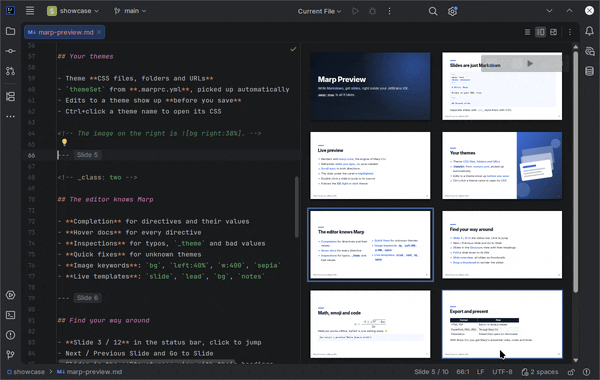
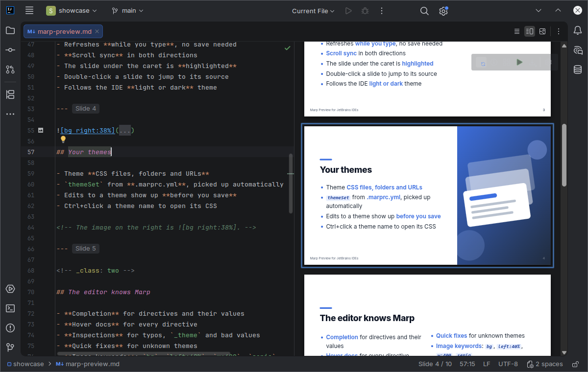
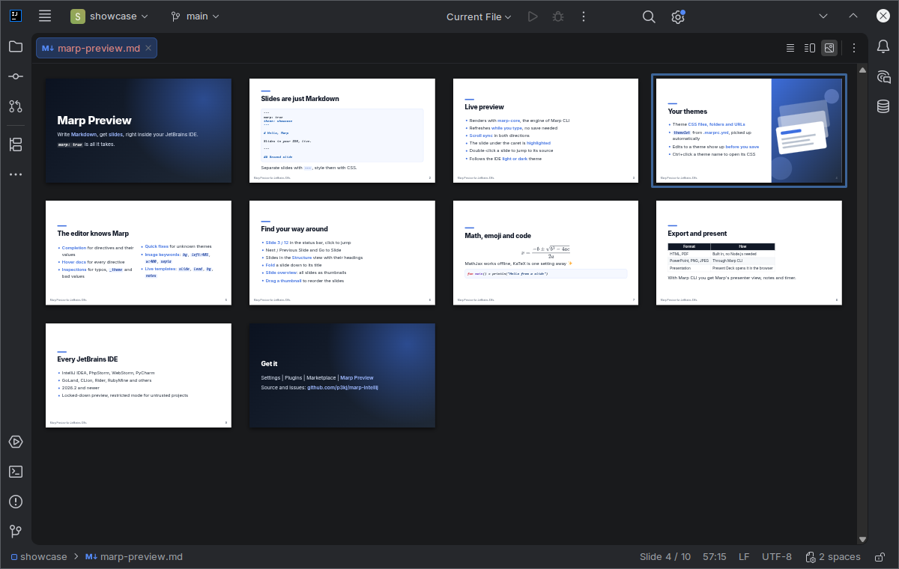
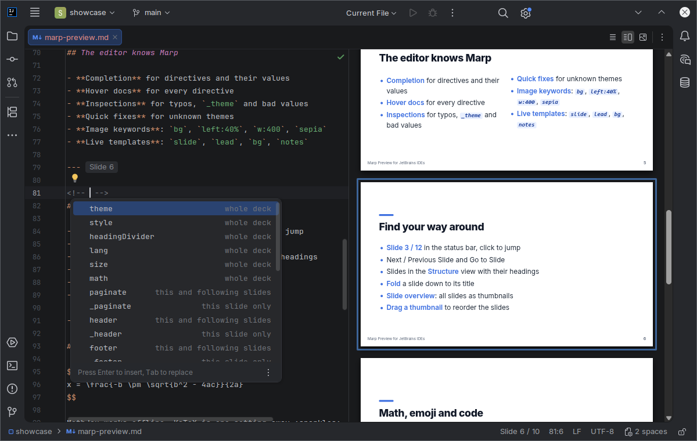
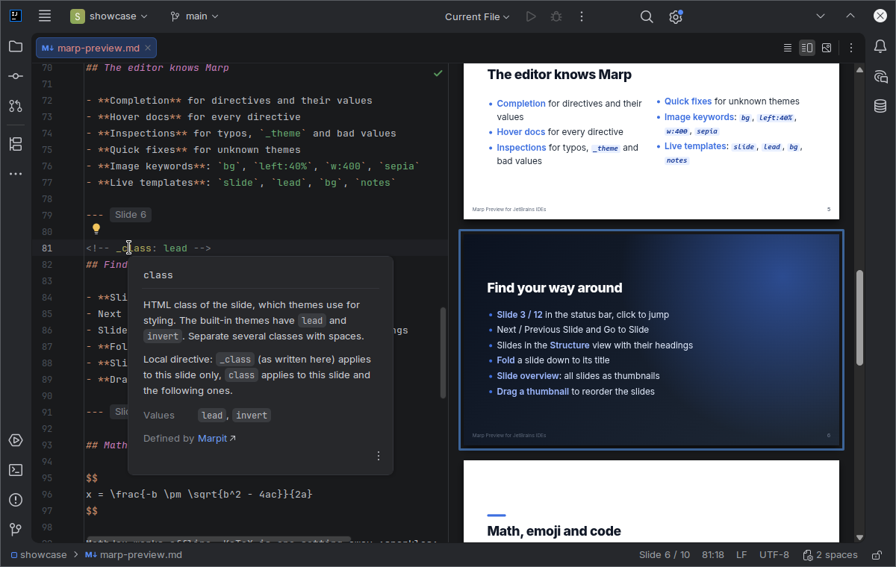
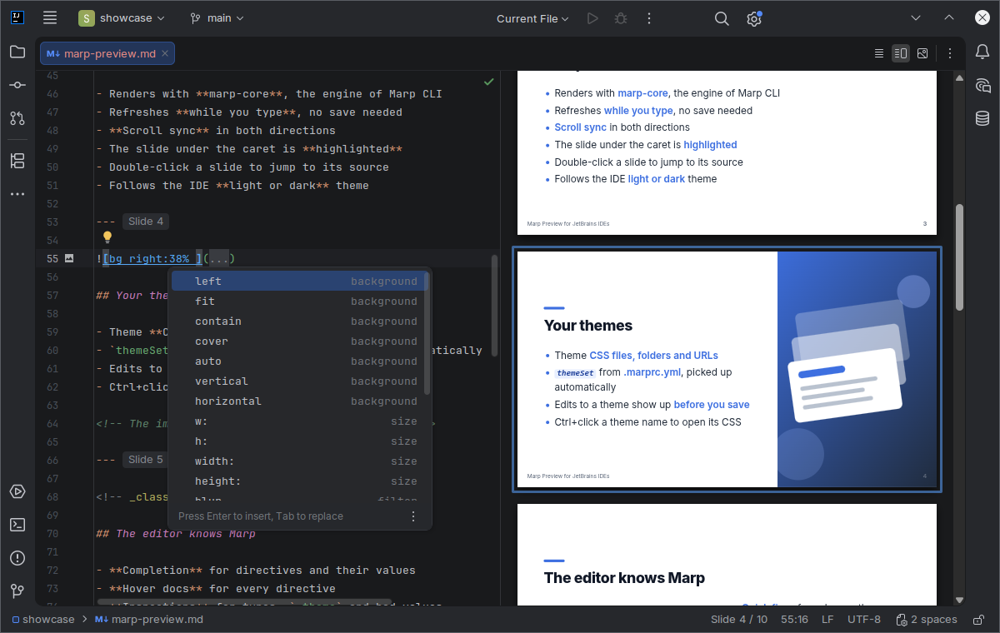
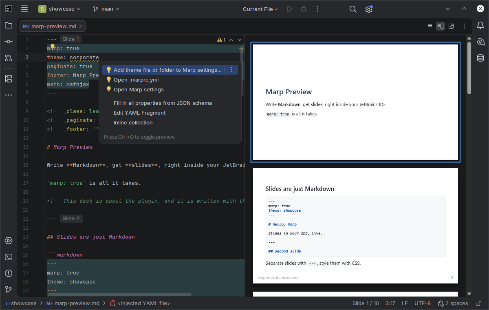
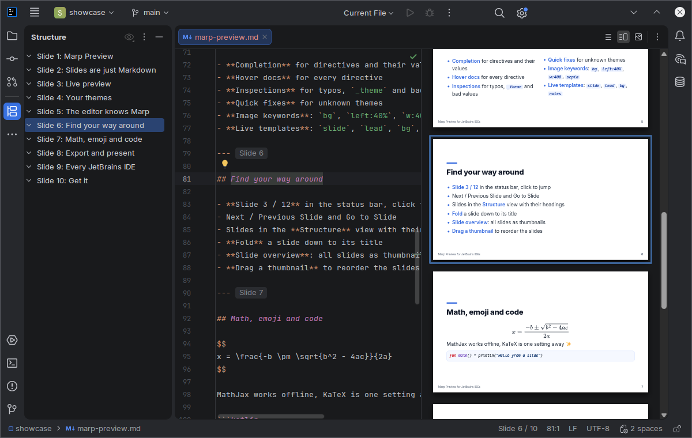
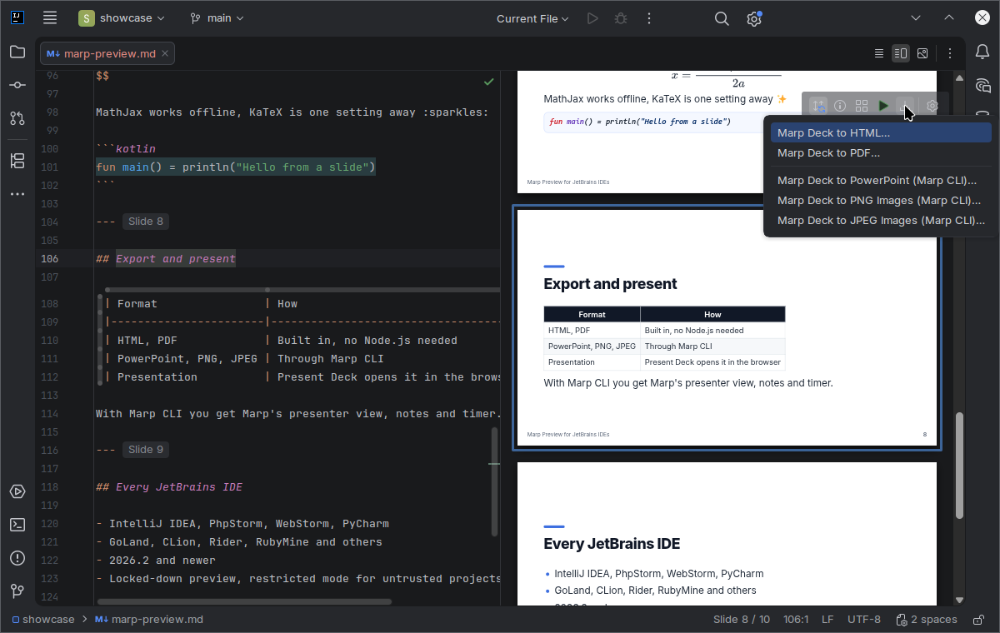

# Marp Preview

[](https://github.com/p3kj/marp-intellij/actions/workflows/build.yml)
<!-- Enable after the first Marketplace release, replace NNNNN with the numeric plugin id:
[](https://plugins.jetbrains.com/plugin/NNNNN-marp-preview)
[](https://plugins.jetbrains.com/plugin/NNNNN-marp-preview)
-->
[](LICENSE)

Marp Preview renders [Marp](https://marp.app/) slide decks inside your JetBrains IDE. The slides appear next to the Markdown editor and refresh while you type, with no Node.js needed.


## Features

**Preview**

- Live preview next to the Markdown editor, rendered by marp-core and refreshed while you type
- Two-way scroll sync, the slide under the caret is highlighted, double-click a slide to jump to its source
- Slide overview: all slides as thumbnails, click one to jump to it, drag one to reorder the deck
- Presenter notes under each slide, on request
- Follows the IDE light or dark theme

**Editing**

- Completion, hover docs and inspections for directives, in HTML comments and in the front matter
- Completion and docs for the image keywords in alt text (`bg`, `left:40%`, `w:400`, `sepia`, ...)
- Unknown theme names are marked, with quick fixes to add a theme; Ctrl+click a theme name to open its CSS
- File | New | Marp Presentation, and live templates `slide`, `lead`, `bg` and `notes`
- The spellchecker knows Marp words, so `marp: true` is not a typo

**Navigation**

- Slides in the Structure tool window and the File Structure popup (Ctrl+F12 / Cmd+F12)
- "Slide 3 / 12" in the status bar, Next / Previous Slide, Go to Slide, slide numbers and folding per slide
- Move Slide Up / Down, Move Statement Up / Down on a slide's `---` line, or drag a thumbnail

**Themes and content**

- Custom themes from CSS files, folders and URLs, and `themeSet` from `.marprc.yml`, picked up automatically
- Theme CSS edits show up live, before the file is saved
- Local images and `` backgrounds, math with MathJax (works offline) or KaTeX, Twemoji
- Inline HTML in slides: off, Marp's allow list or all

**Export and present**

- HTML and PDF (one page per slide) built in, no Node.js needed
- PowerPoint (PPTX), PNG and JPEG through [Marp CLI](https://github.com/marp-team/marp-cli), which you install yourself
- Present Deck in the system browser, from the slide under the caret. With Marp CLI it is Marp's own presentation with presenter view, notes, timer and overview

**Safety and compatibility**

- Locked-down preview page (Content Security Policy, no navigation away) and a restricted mode for untrusted projects
- Works in every IntelliJ-based IDE, no IDE-specific APIs



## Screenshots

| | |
| --- | --- |
|  |  |
| Split view with scroll sync | Slide overview |
|  |  |
| Directive completion | Hover docs |
|  |  |
| Image keywords | Unknown theme quick fixes |
|  |  |
| Structure view | Export to HTML, PDF, PPTX and images |

The deck in these pictures is [docs/showcase/marp-preview.md](docs/showcase/marp-preview.md), a presentation about the plugin written with the plugin. Open `docs/showcase` as a project to try it.

## Installation

The plugin is not on the JetBrains Marketplace yet. Install a release build from disk:

1. Download `marp-intellij-<version>.zip` from the [Releases](https://github.com/p3kj/marp-intellij/releases) page, or build it yourself (see [Development](#development)).
2. Open Settings | Plugins, click the gear icon and choose Install Plugin from Disk.
3. Select the ZIP without unpacking it. No restart is needed.

It needs an IntelliJ-based IDE on the 2026.2 platform or newer (IntelliJ IDEA, PhpStorm, WebStorm, PyCharm, GoLand, CLion, Rider, RubyMine and others) running on the JetBrains Runtime with JCEF, the default in all JetBrains IDEs. Node.js and Marp CLI are only needed for PowerPoint and image export and for Marp's own presentation.

## Quick start

1. Create a deck with File | New | Marp Presentation, or add a front matter with `marp: true` to a Markdown file:

   ```markdown
   ---
   marp: true
   theme: default
   paginate: true
   ---

   # Hello, Marp

   Slides in your IDE, live.

   ---

   ## Second slide

   - Separate slides with `---`
   - Images: ``
   - Math: $E = mc^2$
   ```

2. The file opens in a split view: Markdown on the left, slides on the right. The Editor / Split / Preview buttons in the editor toolbar change the layout. If the file was already open when you added `marp: true`, click the link in the "Marp deck detected" banner.

For a bigger example, open the `samples/` folder of this repository as a project. It has a custom theme, a `.marprc.yml`, local images and two linked decks.

## Documentation

The [user guide](docs/USER_GUIDE.md) explains every feature in detail, including [export](docs/USER_GUIDE.md#export), [Marp CLI](docs/USER_GUIDE.md#marp-cli), [presenting](docs/USER_GUIDE.md#present), [themes](docs/USER_GUIDE.md#themes), [settings](docs/USER_GUIDE.md#settings), [coming from Marp for VS Code](docs/USER_GUIDE.md#coming-from-marp-for-vs-code) and [troubleshooting](docs/USER_GUIDE.md#troubleshooting).

## Roadmap

- A Toggle Marp action that adds or removes `marp: true`, like the "Toggle Marp feature" command of Marp for VS Code

This is a plan, not a promise. Ideas and votes go to the [issue tracker](https://github.com/p3kj/marp-intellij/issues).

## Development

Requirements: JDK 25 and Node.js LTS.

```sh
./gradlew buildPlugin        # build the plugin ZIP into build/distributions
./gradlew runIde             # run a sandbox IDE with samples/ opened
./gradlew check              # Kotlin tests, webview tests, typecheck, NOTICE check
```

The preview page lives in `webview/`, and `cd webview && npm run dev` starts a dev page with a mock IDE host. See [CONTRIBUTING.md](CONTRIBUTING.md) for the full workflow, [docs/ARCHITECTURE.md](docs/ARCHITECTURE.md) for how the plugin is put together and [docs/RELEASING.md](docs/RELEASING.md) for releases.

## Security

The preview page is locked down, and untrusted projects render without raw HTML and custom themes, see [Trust and security](docs/USER_GUIDE.md#trust-and-security). To report a vulnerability, see [SECURITY.md](SECURITY.md).

## License

MIT, see [LICENSE](LICENSE).

## Credits

- [Marp](https://marp.app/) by the Marp team: marp-core and Marpit do the actual rendering.
- Code ported from [marp-vscode](https://github.com/marp-team/marp-vscode) (MIT, Marp team) and from the scroll sync of the [VS Code](https://github.com/microsoft/vscode) Markdown preview (MIT, Microsoft Corporation).
- Third-party packages bundled in the webview are listed in [NOTICE](NOTICE).

Marp Preview is an independent project and is not affiliated with the Marp team.
