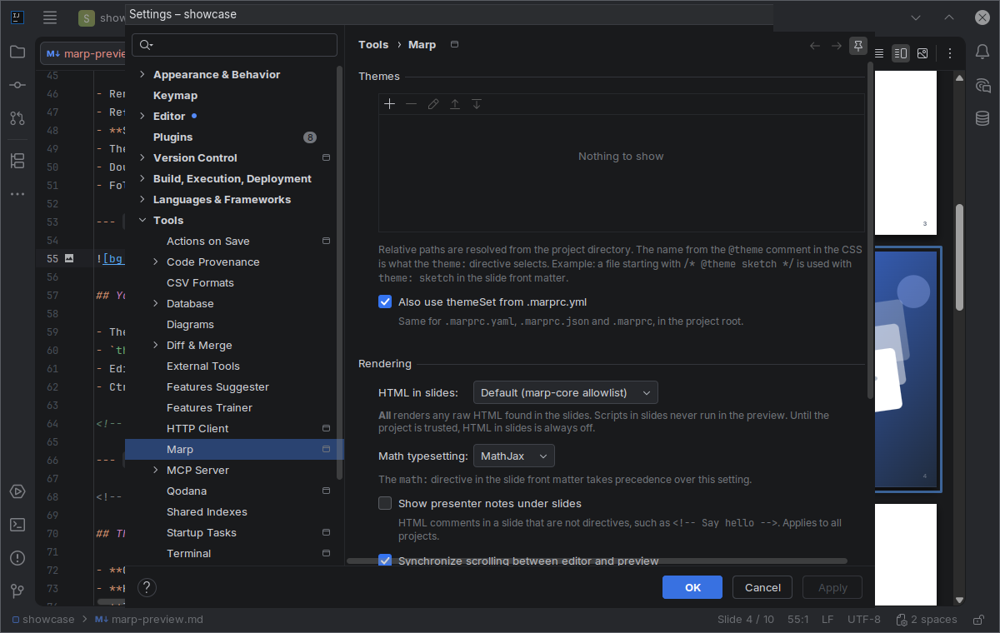

# Screenshots

The deck in these pictures is [showcase/marp-preview.md](showcase/marp-preview.md), a presentation about the plugin written with the plugin. Open `docs/showcase` as a project to try it. The [user guide](USER_GUIDE.md) explains every feature shown here.

## Live editing

The preview adds a new slide while you type, and completing `_class: lead` restyles it.

## Split view with scroll sync

Markdown on the left, slides on the right, the slide under the caret outlined.

## Slide overview

All slides as a grid of thumbnails. Click one to jump to it, drag one to reorder the deck.

## Directive completion

Every directive says where it applies: the whole deck, this and the following slides, or this slide only.

## Hover docs

## Image keywords

Completion of the keywords Marp reads in the alt text of an image.

## Unknown theme quick fixes

## Structure view

## Export

HTML and PDF are built in, PowerPoint and images go through Marp CLI.

## Settings

